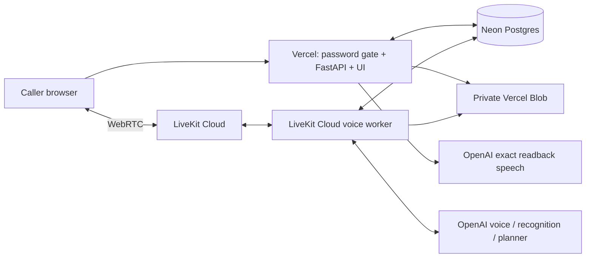

# Cloud deployment

The demo runs independently of the developer laptop:



Production URL: https://sawt-demo.vercel.app. This remains a simulated restaurant,
not a real POS, payment, delivery or human-transfer integration.

## Deployment files

- `vercel.json` routes all requests through `api/index.py`, which exposes the
  existing private gateway. Operator/recording endpoints remain blocked.
- `api/requirements.txt` contains only the HTTP API's dependencies.
- `Dockerfile` runs `voice_worker.py start` as a non-root user.
- `livekit.toml` identifies this deployment, not a credential. Use your own
  project/agent if deploying a fork.
- `.vercelignore` and `.dockerignore` exclude local secrets and recording data.

## Environment

Vercel production requires `OPENAI_API_KEY`, `LIVEKIT_URL`, `LIVEKIT_API_KEY`,
`LIVEKIT_API_SECRET`, `DATABASE_URL`, `BLOB_READ_WRITE_TOKEN`,
`SAWT_DEMO_PASSWORD`, `SAWT_DEMO_SECRET` (32+ characters),
`SAWT_PUBLIC_URL=https://sawt-demo.vercel.app`, `SAWT_AGENT_NAME=sawt-cloud`, and
`SAWT_RUNTIME_DIR=/tmp/sawt`. Set these as server-side environment variables.

LiveKit Cloud supplies its LiveKit credentials. The worker additionally requires
`OPENAI_API_KEY`, `DATABASE_URL`, `BLOB_READ_WRITE_TOKEN`,
`SAWT_AGENT_NAME=sawt-cloud`, and `SAWT_RUNTIME_DIR=/tmp/sawt`.

The API and worker MUST share the same database and dispatch name. The cloud
name intentionally differs from the local `sawt-v2` worker, so a local worker
cannot accidentally take a cloud call. The cloud API refuses to start without
`DATABASE_URL`; it never falls back to an ephemeral local database.

```sh
vercel deploy --prod
lk agent deploy
lk agent status
```

For initial deployment use `lk cloud auth`, then `lk agent create --region
us-east --secrets-file <ignored-file>`. Keep the worker and database near the API
(currently US East). Never commit or paste a secret file into a deployment log.

## State, recordings and limits

Postgres runs the existing transaction contract. Each business transaction uses
a transaction-scoped advisory lock, preserving the demo's single-writer
semantics across hosts. Revision/epoch checks, idempotency, quote invalidation
and timed playback receipts stay inside that boundary. Model requests happen
outside database transactions. This conservative lock is appropriate for the
four-call demo limit, not a claim of production-scale write throughput.

Call creation uses one shared database-backed budget: 120 starts per rolling
hour and four active calls by default. Override `SAWT_MAX_CALLS_PER_HOUR` and
`SAWT_MAX_ACTIVE_CALLS` on Vercel. There is no additional per-process 20-call
cap. Raising these application limits does not raise provider quotas or credits.

Audio is staged in temporary disk space, then uploaded privately: controlled
readbacks during their HTTP stream, caller/generated audio when the worker
closes the call. A sudden worker termination before upload can still lose the
unfinished recording. Generated audio may contain muted/unheard segments;
diagnostic events distinguish it from actual confirmed readback playback.
The worker prunes cloud audio older than seven days after calls finish; an idle
deployment can retain files longer until the next cleanup. Orders/audit data
are stored separately in Postgres. Existing historical calls and recordings remain
on the developer PC by request; they were not exported. Only new cloud calls
use Neon and private Blob storage.

## Browser-free verification

```sh
python -m pytest -q
# Set SAWT_TEST_DATABASE_URL to an unpooled test Postgres connection string:
python -m pytest -q tests/test_postgres_contract.py
python scripts/v2_private_demo_smoke.py --url https://sawt-demo.vercel.app --output runtime/cloud-smoke.json
python scripts/v2_cloud_acceptance.py
```

The Postgres suite creates isolated test schemas. The media scripts use synthetic
caller audio over LiveKit, with no Chrome or local API/worker. The full cloud
test downloads and decodes real readback audio and simulates a playback receipt
only after its duration elapses. It checks premature confirmation rejection,
exact totals, quantity correction and repeat-confirmation idempotency. It is
not a human accent or browser microphone permission test.

Cloud hosting removes laptop uptime and resource dependencies. It does not
remove model-processing latency; report measurements rather than promising
instant responses. Hosting/provider quotas and credits still apply.
