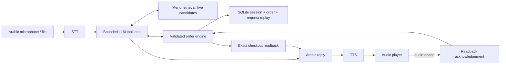
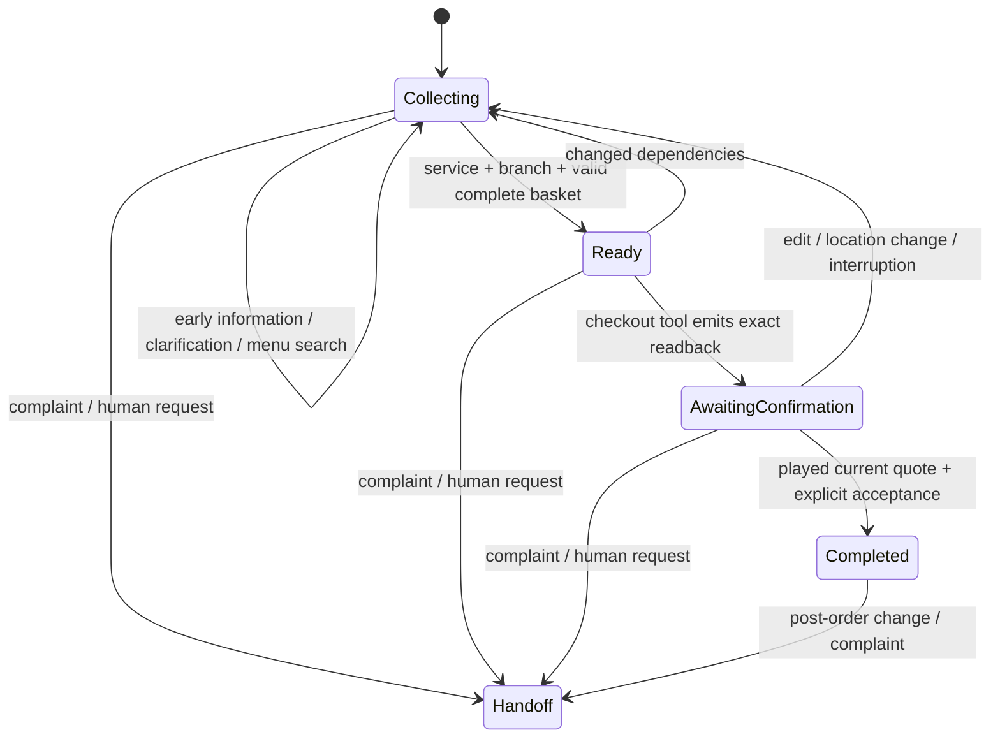

# Design

## Architecture and ownership

One conversational LLM plus a deterministic state machine implemented as derived state and guarded tools. No framework graph or multiple agents are needed. The LLM interprets Arabic and selects operations; Python owns branch selection, valid options, integer prices, checkout, and order creation.

## Journey

Information calls can retrieve the menu without creating a basket. A draft basket may exist before fulfillment details. Missing required choices are visible validation issues and prevent checkout; there are no silently assumed sizes, breads or spice levels.

The database stores service, current location, branch ID, basket lines (stable line IDs, item IDs, quantities, option IDs and notes), revision, quote token, order ID, handoff ticket, bounded history and recent tool events. Menu data stays outside conversation history. Search exposes at most five candidates with their exact option constraints. Audio bytes are processed in memory and returned, not stored by the normal app. Local evaluation scripts explicitly save synthetic audio.

## Dependency invalidation

| Changed answer | Deterministic effect |
|---|---|
| Delivery → pickup | Clear delivery address, zero fee, invalidate quote; existing branch is shown for correction |
| Pickup → delivery | Require a fresh address; do not silently reuse an older delivery address |
| Delivery location | Select serving branch, recalculate fee/ETA and revalidate every basket line |
| Unsupported new location | Clear old location/branch; block checkout instead of retaining old delivery details |
| Pickup branch | Revalidate every item at the new branch |
| Quantity, options, notes, removal | Increment revision and discard quote; reprice from CSV |
| Interrupt | Stop client playback, increment cancellation epoch, clear quote |

Unavailable lines remain visible rather than being silently dropped or replaced. Customer decides the resolution. `view()` derives totals, availability and missing choices from canonical inputs, so cached prices cannot outlive a branch/basket change.

## Confirmation and duplicates

`checkout` emits an exact server-generated Arabic summary and stops the model loop. The summary is not rewritten by the LLM. A fresh token is tied to the current revision. The browser acknowledges that token only on audio `ended`; the explicitly labelled text test path can acknowledge a displayed summary. Replayed audio acknowledgements for old tokens fail.

Short confirmation phrases are accepted only after that acknowledged quote. Exact normalized phrases prevent «نعم بس احذف وجبة» from being treated as acceptance. Other utterances clear the old quote so a later yes cannot answer the wrong question. The model cannot set the confirmation flag. A narrower phrase whitelist can require clarification for uncommon valid expressions; that is safer than guessing and is a known conversational limitation.

HTTP request IDs are scoped to a session. SQLite stores request input hashes and complete responses: repeating the same request returns its previous result; using its ID with different input returns 409. Identical mutating tools repeated within one turn reuse their result. A unique order-per-session database constraint plus persisted order ID prevents duplicate checkout even across request IDs or process restart. Repeating two deliberately identical separate basket lines in one utterance should be represented as one quantity or distinct notes/options because tool deduplication intentionally collapses exact duplicates.

Each LLM turn operates on a deep copy. Up to ten serial tool calls run under a 90-second outer timeout; provider calls have a 35-second timeout. Only a completed response commits the new basket/history/request/order in one SQLite transaction. Provider failure discards speculative changes and invalidates any previous quote. Malformed tool arguments produce an error result for bounded correction. Unknown IDs, illegal options and out-of-range quantities cannot enter canonical state.

Per-session async locks serialize turns; independent sessions can progress independently. An interrupt can increment an epoch while provider work awaits. The turn compares epochs before committing; stale work returns 409. A completed order cannot be retrospectively cancelled by interrupting audio; the UI retrieves authoritative state. Multiple workers require database-backed locking/epochs before deployment.

## Context and failures

The system receives structured current state and the last 12 user/assistant messages, plus current-turn retrieval/tool results. Completed tool transcripts stay out of future prompts. A maximum basket of 30 lines, notes of 300 characters, text of 1,200 characters, five retrieval candidates and bounded loops constrain growth. This is bounded context, not a claim that every turn has the same token count.

On STT failure there is no agent mutation. On LLM failure no speculative basket change commits. On TTS failure the already committed turn remains visible as text; there is no automatic claim that the audio was heard. Checkout remains unacknowledged until the complete readback is consumed. Complaints and common human-request phrases have a deterministic route, so text handoff works during LLM outage; spoken handoff still needs STT.

Menu data lacks ingredients/allergens/opening hours. The prompt requires the agent to say it does not have that information and offer staff assistance; do not infer allergen safety from a dish name. This language behavior must also be checked in live model tests.

## Before real customers

Add continuous VAD/full-duplex streaming, real call transfer with success/failure acknowledgements, POS inventory reservations, authenticated sessions, retention/deletion controls, encrypted production storage, monitoring and structured redaction, geocoded address confirmation, rate limiting, durable distributed cancellation, and staff-reviewed Arabic quality tests. Provider model aliases must be pinned to verified snapshots with recorded latency/cost. Connect order creation to a real idempotent POS API. A local order ID is not a restaurant acceptance receipt.
