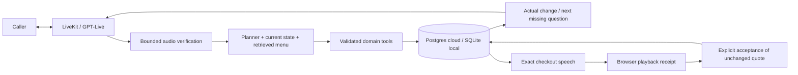

# Design: simple conversation, explicit state

## Product reasoning

The caller should be able to give information in any order, pause and correct a choice without restarting. The UI therefore has a single call action, an audio-reactive orb and a compact receipt. Debug traces live separately. We removed landing-page content, repeated greetings and generic saved-change announcements because they distract from the actual task.

The complexity belongs where mistakes matter: identifying which item changed, recalculating its total, distinguishing yes-to-half-sugar from yes-to-an-order, and rejecting a slow response overtaken by new speech. A natural voice alone does not solve these problems.

## Architecture

The hosted demo separates the Vercel API from the persistent LiveKit Cloud
worker. Both use Neon Postgres for the same transaction contract; local runs use
SQLite. Private Blob storage keeps completed recordings outside ephemeral
containers. See [cloud deployment](CLOUD-DEPLOYMENT.md) for operational limits.

| Component | Responsibility |
|---|---|
| Browser / LiveKit | Microphone capture, transport, playback and interruption signals |
| GPT-Live | Conversational timing and spoken delivery; delegates restaurant work |
| Independent transcription | Verify the bounded captured PCM before business/control actions |
| GPT-4.1 planner | Interpret language, retrieve menu candidates and choose validated tools |
| Domain engine | Valid options, availability, required fields, integer prices and exact readback |
| Postgres / SQLite boundary | Atomic state, revisions, epochs, receipts and one order per session |

Two model responsibilities—voice and business interpretation—are sufficient here. There is no extra intent-classifier service or framework of specialist agents, and no competing second live turn detector. Narrow deterministic controls complement the planner rather than replacing open-ended language understanding.

## Why this stack

Python/FastAPI keeps tools, rules and regression assertions together. SQLite gives the single-host prototype real transactions and unique constraints without another infrastructure service. LiveKit provides WebRTC/media lifecycle. Hosted models allow product iteration without GPU provisioning; the open-weight candidates in EVALUATION.md are a separate proposed evaluation, not the running stack. A small React orb and static caller app avoid requiring a second frontend server just to run the demo.

## Context management

The planner receives structured CURRENT STATE, the last **12 user/assistant messages**, and current-turn tool results. Menu retrieval returns at most **five candidates** per search rather than embedding the 1,728 CSV rows in every prompt. Up to eight distinct current-basket item definitions are supplied from the catalog, so correcting an existing item does not require retrieving its option schema again. Historical tool transcripts do not accumulate across turns. The loop permits at most ten tool steps; V2 delegation has a 45-second outer timeout.

Durable state is the memory of the order: stable line IDs, menu/option IDs, quantities, notes, service, branch, address fields, revision, quote, order ID and pending proposals. History helps interpret references; it is not evidence that a change was saved. Required fields and totals are derived from current state. Ambiguous references are clarified rather than guessed. This bounds context growth but does not imply constant token usage or perfect long-range recall.

## Non-linear conversation

Delivery city, neighborhood, street and building persist independently. They may arrive in any order. Changing city clears dependent old address details; changing neighborhood clears street/building; changing street requires the building again. Switching to pickup clears delivery details. Unsupported locations invalidate the previous destination instead of quietly retaining it.

Questions target missing state. An acknowledgment compares actual before/after state: “خليت الكمية اثنين.” A failed or no-op edit does not receive a success claim. Pending menu proposals bind yes to a line/group/option/revision and expire. Staff offers have separate proposal state, so yes cannot accidentally confirm an order. The 37 reusable phrases live in data/conversation-copy.json; copy changes cannot authorize transactions.

## Revisions, epochs and checkout

A revision identifies the current order; an epoch invalidates work superseded by new speech. Provider calls run outside database transactions. A completed staged bundle commits only when both still match. Tools validate IDs/options and calculate prices in integer halalas from the unchanged CSV. Repeated operation IDs replay stored responses; conflicting reuse is rejected.

Checkout emits an exact server-generated summary tied to the current revision: every item, quantity, option, note, fulfillment, branch, applicable fee, total and ETA. The voice model does not paraphrase this summary. A current completed playback receipt and separate explicit acceptance are required to create the mock order. Edits or interruption invalidate stale readback. A unique order-per-session constraint prevents duplicate orders across repeated yes responses and process restarts.

Playback acknowledgment is not proof that a human actually heard the speakers. Backend tests that simulate receipts are labelled as such. Generated provider audio, including muted output, is also not a receipt.

## Recognition and latency tradeoffs

Human testing exposed a complaint misheard as a request to stay quiet. Bounded audio verification, quantity/negation/question disagreement checks and distinct wait/recover/end routes address that failure without letting captions directly authorize an order.

Later testing exposed provider timestamps ahead of the captured PCM clock after stalls. Fragments now carry the capture position observed when they arrived; ahead-of-audio timestamps use that anchor plus pre/post-roll. This is a bounded alignment heuristic, not forced alignment. Missing/expired audio still requires clarification.

High-frequency diagnostic writes now run through a bounded background queue and batch database writes. Speech invalidates pending work once per unsettled burst; the flag resets before verification so new speech can supersede that work. The caption settlement interval is 750 ms. The orb reads the existing microphone locally instead of waiting only for participant-level updates. It never acquires another microphone or routes input to the speakers.

Verification adds latency: settlement, transcription, tool calls and speech scheduling remain sequential for business turns. We do not claim the hosted-model feel of unrestricted social chat. Stage timings and end-to-end first useful audible response must both be measured. A future faster policy must pass the same order-invariant tests; removing confirmation or guessing through uncertainty is not an acceptable optimization.

The V2 planner returns independent lookups and known edits in batches (up to eight calls per response, ten tools total). Execution is sequential against a staged copy, with validation and duplicate protection on each operation. `ask_choice` or `checkout` may be the final call after mutation tools in the same batch. Any failed mutation or rejected choice prevents that final action, and its normal domain validation still runs. Other terminal tools, especially `confirm`, must be alone. The same revision/epoch commit and heard-readback confirmation gates remain in place. GPT-Live and GPT-4.1 are unchanged.

The submission update measured three paired correction/readback requests against the previous implementation: three model requests became one, and median planner time decreased from 1.933 seconds to 0.815 seconds. Every paired run checked quantity, unchanged options, exact total and an unconfirmed readback. This is planner-only timing for one request, not a claim that all voice turns answer in under a second. Reproduce with `scripts/v2_planner_roundtrip_compare.py --baseline-source <previous-agent.py>`; the baseline source is a saved previous `sawt/agent.py`. This follows [OpenAI's guidance on reducing sequential requests](https://developers.openai.com/api/docs/guides/latency-optimization), with correctness gates retained.

The same release reproduced a clipped price question from synthetic cloud audio: the old 6.6–9.45 second window transcribed «تم سندويش الشاورما»; a 5.0–9.45 second window retained «بكم سندويش الشاورما». Verification now keeps three seconds before approximate captions, bounded by the previous consumed caption's capture position. This adjusts the verification clip, not the live turn detector or the microphone stream. Semantic disagreement still requires clarification.

Three paired development runs of the same two-item Arabic request reduced planner requests from eight to three and median planner time from 5.734 to 3.013 seconds. A public HTTPS/LiveKit synthetic replay observed saved-state completion at 6.00 seconds after input, versus the prior 9.78 seconds. Received audible output after completion was detected at 6.88 seconds. This is a small development sample, not a latency SLO or human assessment; received RMS does not establish the semantic first useful word. Reproduce planner comparison with `python scripts/v2_latency_compare.py` (paid API calls).

The final rerun after accuracy repairs observed completion at 5.78 seconds and post-completion audio at 6.47 seconds; all 422 offline tests passed. The host also had only 321 MB free RAM during this work; stale workspace test processes were stopped. These observations do not isolate host paging from provider/network variance. Accuracy replays exposed and repaired service-change-only responses, skipped food saves after fulfillment edits, repeated-summary quote gating, and empty full-address calls that should save partial fields.

## Failure behavior and production boundary

No usable transcript means clarification. Failed speculative planner work does not commit. Failed TTS does not mark a quote heard. Cancellation clears only an unconfirmed draft and keeps the call open. Explicit hang-up has a bounded closing line; the End button disconnects directly. Missing ingredients, hours and live tracking cannot be inferred from dish names or free-text notes.

Local traces connect speech, verification, tools, revisions, receipts and state; audio and databases are ignored by Git. Diagnostic queue drops are counted. Synthetic tests establish specific behavior, not a Saudi-speaker benchmark or a production SLO.

Real deployment still requires authenticated tenants, managed persistence/retention, distributed ownership, actual POS/payment/staff integrations, service-area and stock data, load testing and monitored rollout. PRODUCT.md proposes the safe-change workbench. This challenge prototype favors clear ownership, a simple caller experience and honest evidence over claims of production readiness.

## Audio output and regression gates

Business-turn validation mutes samples through `SpeechGate`, while keeping LiveKit's audio destination attached. Disabling the SDK destination mid-conversation was unsafe for liveness: a speech task could snapshot no destination and remain inaudible after output was re-enabled. The gate forwards timing and playback events, clears queued speech when muted, and restores audible frames on the same destination. A guarded fallback can speak the verified reply if no audible frames reach that sink; it rechecks new input and the call epoch after synthesis so stale audio is discarded.

The cloud test caller publishes real synthetic PCM and observes returned PCM and durable state separately. Missing audio, wrong basket state and latency failures remain separate failures. See [VOICE-TESTS.md](VOICE-TESTS.md) and the baseline/reruns in `evidence/v2/voice-readiness.json`. Neither a passing unit count nor an eight-second stall threshold is a claim of natural conversational latency.
