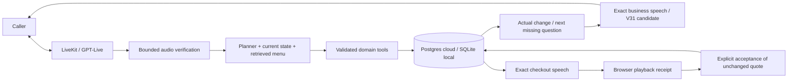

# Design: simple conversation, explicit state

## Product reasoning

The caller should be able to give information in any order, pause and correct a choice without restarting. The UI therefore has a single call action, an audio-reactive orb and a compact receipt. Debug traces live separately. We removed landing-page content, repeated greetings and generic saved-change announcements because they distract from the actual task.

The complexity belongs where mistakes matter: identifying which item changed, recalculating its total, distinguishing yes-to-half-sugar from yes-to-an-order, and rejecting a slow response overtaken by new speech. A natural voice alone does not solve these problems.

## Architecture

The hosted demo separates the Vercel API from the persistent LiveKit Cloud
worker. Both use Neon Postgres for the same transaction contract; local runs use
SQLite. Private Blob storage keeps completed recordings outside ephemeral
containers. See [cloud deployment](CLOUD-DEPLOYMENT.md) for operational limits.

| Component | Responsibility |
|---|---|
| Browser / LiveKit | Microphone capture, transport, playback and interruption signals |
| GPT-Live | Listening and conversational timing; social speech; delegates restaurant work |
| Exact TTS / V31 candidate | Speak the validated business response without another semantic rewrite |
| Independent transcription | Verify the bounded captured PCM before business/control actions |
| GPT-4.1 planner | Interpret language, retrieve menu candidates and choose validated tools |
| Domain engine | Valid options, availability, required fields, integer prices and exact readback |
| Postgres / SQLite boundary | Atomic state, revisions, epochs, receipts and one order per session |

Two model responsibilities—voice and business interpretation—are sufficient here. There is no extra intent-classifier service or framework of specialist agents, and no competing second live turn detector. Narrow deterministic controls complement the planner rather than replacing open-ended language understanding.

## Why this stack

Python/FastAPI keeps tools, rules and regression assertions together. SQLite gives the single-host prototype real transactions and unique constraints without another infrastructure service. LiveKit provides WebRTC/media lifecycle. Hosted models allow product iteration without GPU provisioning; the open-weight candidates in EVALUATION.md are a separate proposed evaluation, not the running stack. A small React orb and static caller app avoid requiring a second frontend server just to run the demo.

## Context management

The planner receives structured CURRENT STATE, the last **12 user/assistant messages**, and current-turn tool results. Menu retrieval returns at most **five candidates** per search rather than embedding the 1,728 CSV rows in every prompt. Up to eight distinct current-basket item definitions are supplied from the catalog, so correcting an existing item does not require retrieving its option schema again. Historical tool transcripts do not accumulate across turns. The loop permits at most ten tool steps; V2 delegation has a 45-second outer timeout.

Durable state is the memory of the order: stable line IDs, menu/option IDs, quantities, notes, service, branch, address fields, revision, quote, order ID and pending proposals. History helps interpret references; it is not evidence that a change was saved. Required fields and totals are derived from current state. Ambiguous references are clarified rather than guessed. This bounds context growth but does not imply constant token usage or perfect long-range recall.

## Non-linear conversation

Delivery city, neighborhood, street and building persist independently. They may arrive in any order. Changing city clears dependent old address details; changing neighborhood clears street/building; changing street requires the building again. Switching to pickup clears delivery details. Unsupported locations invalidate the previous destination instead of quietly retaining it.

Questions target missing state. An acknowledgment compares actual before/after state: “خليت الكمية اثنين.” A failed or no-op edit does not receive a success claim. Pending menu proposals bind yes to a line/group/option/revision and expire. Staff offers have separate proposal state, so yes cannot accidentally confirm an order. The 37 reusable phrases live in data/conversation-copy.json; copy changes cannot authorize transactions.

## Revisions, epochs and checkout

A revision identifies the current order; an epoch invalidates work superseded by new speech. Provider calls run outside database transactions. A completed staged bundle commits only when both still match. Tools validate IDs/options and calculate prices in integer halalas from the unchanged CSV. Repeated operation IDs replay stored responses; conflicting reuse is rejected.

Checkout emits an exact server-generated summary tied to the current revision: every item, quantity, option, note, fulfillment, branch, applicable fee, total and ETA. The voice model does not paraphrase this summary. A current completed playback receipt and separate explicit acceptance are required to create the mock order. Edits or interruption invalidate stale readback. A unique order-per-session constraint prevents duplicate orders across repeated yes responses and process restarts.

Playback acknowledgment is not proof that a human actually heard the speakers. Backend tests that simulate receipts are labelled as such. Generated provider audio, including muted output, is also not a receipt.

## Current speech candidate: V31

V30's real received audio asked “عادي ولا أسمر؟” even though the backend had
saved saj and asked delivery or pickup. GPT-Live commentary is something to say
in its own words; acknowledgment never guaranteed semantic fidelity. V31 sends
the validated restaurant response through exact streamed TTS instead. GPT-Live
continues listening and social turn-taking, but cannot audibly rewrite a
business question. This candidate is not deployed or live-verified yet.

The speech gate keeps its output destination attached. A task-local permit
allows only the explicit audio iterator through while business output is held;
the SDK's resampling runs in that same task. New input revokes the permit, and
the generation checks the current epoch before starting. Older cleanup cannot
cancel newer speech. Checkout retains its separate receipt requirements.

Removing the commentary acknowledgment and delayed fallback eliminates those
two waits. Recognition, planning and TTS still take time. Live latency and
interruption measurements are pending funding. The release evidence preserves
the prior 13.81-second outlier rather than calling this change a proven fix.

## Recognition and latency tradeoffs

The measurements and incremental changes below describe the development
history. The current candidate supersedes the commentary/fallback reply path.

Human testing exposed a complaint misheard as a request to stay quiet. Bounded audio verification, quantity/negation/question disagreement checks and distinct wait/recover/end routes address that failure without letting captions directly authorize an order.

Later testing exposed provider timestamps ahead of the captured PCM clock after stalls. Fragments now carry the capture position observed when they arrived; ahead-of-audio timestamps use that anchor plus pre/post-roll. This is a bounded alignment heuristic, not forced alignment. Missing/expired audio still requires clarification.

High-frequency diagnostic writes now run through a bounded background queue and batch database writes. Speech invalidates pending work once per unsettled burst; the flag resets before verification so new speech can supersede that work. The caption settlement interval is 750 ms. The orb reads the existing microphone locally instead of waiting only for participant-level updates. It never acquires another microphone or routes input to the speakers.

Verification adds latency: settlement, transcription, tool calls and speech scheduling remain sequential for general business turns. A reviewed human call exposed a counterexample to trusting a second recognizer unconditionally: correct live captions of pickup became unrelated words in secondary STT. A whole explicit answer to a currently stored draft question can now use the live caption directly. This is limited to known catalog options and the initial delivery/pickup question; quantities, mixed requests, yes/confirmation, cancellation, service switches and completed orders still require independent verification. Bounded captured audio must exist in either path. New fulfillment disagreement checks prevent secondary STT from silently turning pickup into a greeting. The previous question and restaurant vocabulary provide transcription hints, never words to invent.

The cloud media loop never waits synchronously on Postgres. Caption callbacks queue ordered epoch invalidations; delegation awaits that boundary before planning. All business DB operations remain checked inside their original transactions on worker threads. Audio can flow while storage waits. Diagnostic `voice.scheduler` events measure the worst scheduling delay in each five-second sample. The API similarly runs synchronous endpoints in the framework's thread pool and awaits offloaded receipt operations while streaming readback.

Before planning, bounded read-only retrieval supplies at most five relevant catalog candidates, existing basket definitions and relevant branch definitions. The last question helps resolve a short follow-up such as chicken after a shawarma question. Retrieval does not save selections, prove an unavailable dish exists or remove mutation validation. An unresolved dish identity takes precedence over unrelated fulfillment questions. A clear answer that continues an order must save the known dish as a draft even when another modifier needs clarification.

We still measure actual received speech separately from state completion. The live model stays GPT-Live with GPT-4.1 planning. `SAWT_VOICE=marin` gives live speech, exact checkout and recovery the same voice identity; the two synthesis models can still differ in pronunciation. The prompt avoids habitual checking announcements and repeated greetings. Automated transcription of received synthetic assistant audio catches missing/repeated questions, but does not establish human-rated Saudi accent quality.

The V2 planner returns independent lookups and known edits in batches (up to eight calls per response, ten tools total). Execution is sequential against a staged copy, with validation and duplicate protection on each operation. `ask_choice` or `checkout` may be the final call after mutation tools in the same batch. Any failed mutation or rejected choice prevents that final action, and its normal domain validation still runs. Other terminal tools, especially `confirm`, must be alone. The same revision/epoch commit and heard-readback confirmation gates remain in place. GPT-Live and GPT-4.1 are unchanged.

The submission update measured three paired correction/readback requests against the previous implementation: three model requests became one, and median planner time decreased from 1.933 seconds to 0.815 seconds. Every paired run checked quantity, unchanged options, exact total and an unconfirmed readback. This is planner-only timing for one request, not a claim that all voice turns answer in under a second. Reproduce with `scripts/v2_planner_roundtrip_compare.py --baseline-source <previous-agent.py>`; the baseline source is a saved previous `sawt/agent.py`. This follows [OpenAI's guidance on reducing sequential requests](https://developers.openai.com/api/docs/guides/latency-optimization), with correctness gates retained.

The same release reproduced a clipped price question from synthetic cloud audio: the old 6.6–9.45 second window transcribed «تم سندويش الشاورما»; a 5.0–9.45 second window retained «بكم سندويش الشاورما». Verification now keeps three seconds before approximate captions, bounded by the previous consumed caption's capture position. This adjusts the verification clip, not the live turn detector or the microphone stream. Semantic disagreement still requires clarification.

A later real-media run exposed an 8.55-second reply for «أبي شكشوكة كبير تميس وتوصيل»: the planner searched both the dish and bread, then made extra reply rounds. A bounded fast path now recognizes an exact catalog dish, one portion, one bread and optional delivery/pickup on an empty draft. It invokes the same staged tools and state-derived next question without a model request. Any quantity, extra dish, note, condition, question, correction or existing basket falls back to the planner. This intentionally optimizes a small, provable language form rather than trying to replace general understanding with a large rule system.

Three paired development runs of the same two-item Arabic request reduced planner requests from eight to three and median planner time from 5.734 to 3.013 seconds. A public HTTPS/LiveKit synthetic replay observed saved-state completion at 6.00 seconds after input, versus the prior 9.78 seconds. Received audible output after completion was detected at 6.88 seconds. This is a small development sample, not a latency SLO or human assessment; received RMS does not establish the semantic first useful word. Reproduce planner comparison with `python scripts/v2_latency_compare.py` (paid API calls).

The final rerun after accuracy repairs observed completion at 5.78 seconds and post-completion audio at 6.47 seconds; all 422 offline tests passed. The host also had only 321 MB free RAM during this work; stale workspace test processes were stopped. These observations do not isolate host paging from provider/network variance. Accuracy replays exposed and repaired service-change-only responses, skipped food saves after fulfillment edits, repeated-summary quote gating, and empty full-address calls that should save partial fields.

## Failure behavior and production boundary

No usable transcript means clarification. Failed speculative planner work does not commit. Failed TTS does not mark a quote heard. Cancellation clears only an unconfirmed draft and keeps the call open. Explicit hang-up has a bounded closing line; the End button disconnects directly. Missing ingredients, hours and live tracking cannot be inferred from dish names or free-text notes.

Local traces connect speech, verification, tools, revisions, receipts and state; audio and databases are ignored by Git. Diagnostic queue drops are counted. Synthetic tests establish specific behavior, not a Saudi-speaker benchmark or a production SLO.

Real deployment still requires authenticated tenants, managed persistence/retention, distributed ownership, actual POS/payment/staff integrations, service-area and stock data, load testing and monitored rollout. PRODUCT.md proposes the safe-change workbench. This challenge prototype favors clear ownership, a simple caller experience and honest evidence over claims of production readiness.

## Audio output and regression gates

The latest work separates an acoustic disagreement from a slow or absent reply.
A live pickup caption can answer an already stored pickup/delivery question
without a second recognizer turning it into a greeting. This narrow route
cannot confirm an order, choose a quantity, or interpret a compound request.
Other business turns retain bounded PCM verification. When critical details
disagree, one different acoustic model transcribes the same audio without being
shown either disputed transcript; the same quantity/negation/control checks
still apply. An unresolved disagreement asks the caller to clarify. A synthetic
transport recording reproducibly turned «three» into a dish name in the default
recognizer; GPT-4o Transcribe recovered the quantity from that same PCM. Its
[scheduled retirement](https://developers.openai.com/api/docs/deprecations)
on 2027-02-26 makes revalidation of the recovery model an explicit maintenance task.

`finish_draft` lets a planner batch all clear edits and finish with the next
missing question in one request. The application generates the new line ID and
question; the model cannot invent it. A failed edit or rejected choice blocks
the terminal action. Information questions still use menu facts, and confirmed
orders still require the latest complete playback receipt and explicit consent.

Cloud database operations are moved off the media event loop. Caption epoch
invalidations remain ordered even while database calls await their thread.
Scheduler lag and missing-reply decisions are audited. Audible output detection
uses frame RMS, because one PCM peak can be a click rather than spoken audio.
Measured results and remaining gates are recorded in `evidence/v2/submission-final.json`;
these changes are not a claim of certified conversational latency. Billing failure closes the
call visibly instead of asking the caller to repeat into an unavailable service.

V2 uses `SAWT_VOICE=marin` for live speech, checkout and recovery. A speech-only
monetary renderer converts `18.00 ريال` to `ثمانية عشر ريال` and `18.50 ريال` to
`ثمانية عشر ريال وخمسين هللة`, preserving exact value and the final confirmation question.
Spelling out money avoids the digit-by-digit or garbled reading observed in the
funded speech test; receipt and stored amounts remain numeric and unchanged.
Stored prices and receipt/revision validation are unchanged. Synthetic received
speech is independently transcribed for review; natural Saudi delivery still
needs a human listening check.

Business-turn validation mutes samples through `SpeechGate`, while keeping LiveKit's audio destination attached. Disabling the SDK destination mid-conversation was unsafe for liveness: a speech task could snapshot no destination and remain inaudible after output was re-enabled. The gate forwards timing and playback events, clears queued speech when muted, and restores audible frames on the same destination. A guarded fallback can speak the verified reply if no audible frames reach that sink; it rechecks new input and the call epoch after synthesis so stale audio is discarded.

The cloud test caller publishes real synthetic PCM and observes returned PCM and durable state separately. Missing audio, wrong basket state and latency failures remain separate failures. See [VOICE-TESTS.md](VOICE-TESTS.md) and the baseline/reruns in `evidence/v2/voice-readiness.json`. Neither a passing unit count nor an eight-second stall threshold is a claim of natural conversational latency.

Call readiness also has a boundary: a joined LiveKit room does not establish that the microphone stream and GPT-Live session are both connected. The worker waits for those two signals before sending `ready`; a bounded startup timeout ends an unavailable call with an error. Recognition retries recheck the input epoch and fragment count before publishing a clarification, so a superseded partial sentence cannot interrupt the completed request with an obsolete “please repeat.”

For business replies, the worker correlates the commentary event with its provider acknowledgment before reopening audio, with a bounded one-second wait and a fresh epoch check. That acknowledgment means context was injected, not that the caller heard the answer; checkout still needs the separate playback receipt. The Postgres pool validates idle connections before lending them to a transaction, avoiding reuse of a closed socket after host/database idling. Recovery happens before the operation begins, without automatically replaying an uncertain order commit.

These boundaries follow the documented distinction between [context acknowledgment and completed speech](https://developers.openai.com/api/reference/resources/live/fork-websocket), and the pool's [connection-quality check on checkout](https://www.psycopg.org/psycopg3/docs/advanced/pool.html#connection-quality). They add bounded work; the measured first-audio latency in the release evidence remains the authority for caller responsiveness.

Recovery and goodbye speech stream 24 kHz PCM into 20 ms frames. Playback can begin before synthesis completes; it no longer downloads and decodes a complete MP3 first. A guard is checked after the first network chunk and again after interrupting older audio, so a stale fallback cannot start merely because its request finished late. Odd network splits are reassembled into complete PCM samples, and cancellation closes the speech stream. This removes a buffering delay; it does not eliminate recognition, planner, provider or network latency.

A later synthetic audit found a correctness hole that the original basket assertions missed: the planner chose delivery for a dish-only request. V23 requires explicit customer evidence at the staged fulfillment boundary, including address tools that implicitly switch service. Delivery and pickup have no default. Negated, conditional, quoted or ambiguous choices stay unresolved; already selected delivery allows subsequent address answers without making the customer repeat the service. This deliberately favors clarification over an unsupported choice, and does not claim complete semantic understanding from lexical rules. Cloud assertions now check that service stays unset on dish-only orders.

The same run took 10.25 seconds to answer an unavailable bread correction because it used two planner passes. A bounded single-dish bread correction now validates directly against the menu, invalidates the rejected old choice, and explains the available alternatives. Mixed requests and ambiguous targets still use the planner. Brown bread cannot silently become brioche, and the acknowledgment no longer says the sandwich's required bread was simply removed. This is another small deterministic shortcut around a general planner, not a separate intent-classifier service. Its current end-to-end measurements are reported in the release evidence.

Agreement between recognizers is not proof that words make sense. In V23, both produced `الذي الطلب كله` for a synthetic cancellation. V24 detects that narrow malformed whole-order fragment and requests a repeat without canceling or checking out. It does not guess the intended verb. A later explicit cancellation can then clear the draft. The fused form `برمو صاج` also resolves through the bounded bread-correction grammar without changing its letters or substituting another bread.

A short staff-decline reply was marked audible at the worker but not detected at the caller. The root cause was not conclusively isolated. The output gate now requires roughly 80 ms of signal, resetting between replies, before suppressing missing-speech recovery. This mitigates residual frames/brief clicks but is still an outgoing signal test, not a playback receipt. Failed cloud callers now save compact received-audio diagnostics; a passing rerun is reported as limited evidence rather than proof the intermittent failure cannot recur.

The full V24 run then passed functional checks but exposed a 9.69-second audio-check response. Its secondary-verification stage consumed 7048 ms. V25 treats a complete “تسمعني؟” phrase as a nontransactional audio check and answers it directly after validating the captured audio window and current epoch. This cannot edit a basket, confirm, cancel, pause or close a call. Mixed phrases and the easily confused “ما قاعد أتكلم / ما قاعد تتكلم” still require independent recognition. The optimization removes an unnecessary network dependency for this narrow question; general business turns still pay for recognition and validation.

The funded cloud tests exposed several additional failure modes. Audio resumes
at a short silence when a speculative phrase is still playing, so its last
syllables do not leak ahead of the verified answer. Recognition recovery checks
critical meaning against both prior transcripts: a second opinion cannot erase
a detected cancellation and silently continue ordering. In that case the caller
gets a clarification, with the draft unchanged.

Whole city/neighborhood answers matching the current delivery question and
configured locations save directly. No model request is needed for that narrow
case; unknown locations, free text, mixed requests and corrections retain the
planner path. An explicit final “and read the order” clause triggers the exact
readback after successful edits, while failed edits block it. A rejected early
confirmation can still lead to a fresh unheard readback, never an order. An
unrelated successful addition cannot suppress another dish's identity question.

The received-speech test also found TTS omitting the final confirmation question
despite correct input text. The default Marin checkout now streams the summary
body as PCM and appends a separately generated, independently transcribed
`نأكد الطلب؟` asset. One MP3 encoder spans both segments, so this is a continuous
audio file rather than concatenated MP3 headers. Receipt duration covers both.
The spoken asset and generation metadata are in `data/voice/`; other configured
voices synthesize that question separately. This protects the final question;
it does not certify every pronunciation or every dynamically spoken item.

Five short recovery/goodbye phrases now have verified PCM assets for the default
Marin voice and exact speech model. The cache key includes exact text, voice and
model, and the loader checks the asset hash. Changed phrases or other voices
fall back to live synthesis; dynamic order summaries are never replaced by a
cached generic answer. Each asset was independently transcribed; generations
that omitted words were rejected. This removes a speech-network dependency for
fixed lines, without claiming a human Saudi accent rating. Playback diagnostics
separate first chunk, interruption completion and final playout to make later
stalls attributable instead of guessing from a single timeout.

Continuous captions are not reliable sentence boundaries. One real synthetic
trace split “انتظر شوي لو سمحت” after the accepted pause and verified the tail
as “لو سمحت”. The planner then treated it as a new request. While already paused,
V27 consumes only exact polite tails silently; “لو سمحت أبي شاورما” still resumes
normal verification. Replayed consumed captions also cannot reopen muted output.
This small state-dependent rule fixes an observed boundary problem without
adding a separate classifier or delaying every turn to guess sentence endings.

A V27 readback received its first packet, then its provider stream failed before
completion. The receipt correctly remained invalid, but the client mislabeled
every 409 response as an order edit and hid retry. V28 distinguishes incomplete
playback from a changed order. It keeps the draft, offers a fresh readback, and
still refuses confirmation on incomplete or stale receipts. A ten-second client
watchdog handles preparation/buffering stalls; playing audio clears it, and an
obsolete timer cannot cancel a newer playback. Speech HTTP idle waits are
bounded to eight seconds without shortening planner/transcription requests.
These are failure-recovery bounds, not desired response-time targets. Private
audit events record exception/cause types, elapsed time and byte count, without
provider response bodies or credentials.

The next cloud run reproduced that provider stall outside Vercel: a tiny PCM
fragment arrived, followed by an idle timeout. Streaming now holds about 250 ms
of initial PCM within a three-second startup deadline. If startup fails, it
discards those unplayed bytes and retries once. After any audio is yielded,
failure cannot replay or splice a second answer; partial checkout remains
unconfirmable. Billing failures never retry. This favors a small startup buffer
over exposing a click followed by silence, without hiding failed streams.

We also reduced the speech instructions to reading the supplied Arabic exactly
in a clear Saudi accent at a natural pace. Across one checkout fixture with
three interleaved samples per style, compact instructions began audio in
0.66–0.95 seconds versus 0.88–5.30 seconds previously. Both retained the tested
items, amount and confirmation question in independent ASR. This is a small
development comparison, not proof of causality, human pronunciation or overall
call latency. GPT-Live and Marin remained unchanged.

A complete, unambiguous English single-drink request can supplement a modifier
the planner omitted, using only the current catalog's options. Unknown words,
mixed drinks, negation and conditions reject that shortcut. A vague Saudi
“سكر وسط” instead produces “تقصد نصف سكر؟” bound to the basket line and revision;
only the answer sets half sugar. Size and ice edits already saved remain saved.
That yes cannot authorize an order. Staff-offer wording is similarly tied to a
pending proposal: speaking an offer cannot silently create a staff ticket.
