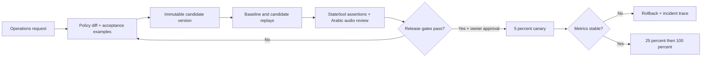

# Safe changes: a release workbench for operations

The requested change is precise: a family meal makes the caller eligible for one relevant add-on offer before checkout; a decline suppresses future offers for that conversation. The product creates a versioned policy change with executable expectations, then compares it with the current release before rollout. This document is a proposal, not a claim that the release product is implemented.

## Proposed policy

Use a structured policy with trigger `basket contains family option`, timing `before checkout`, frequency `once per conversation`, and catalog eligibility `available at current branch + relevant category + complete price`. Store offer state separately from basket revision: `not_offered → offered → accepted/declined`. A basket edit must not reset a decline. An interrupted offer can be marked offered when playback begins; do not repeat it automatically. Clarify only when the customer asks. If the customer changes branch before accepting, revalidate the suggested add-on. Acceptance creates a normal validated basket edit and requires a new final total; it is not final order confirmation.

## Workflow



Candidate manifests pin prompt/policy hashes, application commit, model IDs/snapshots, menu version, tool schemas, voice configuration, test-suite hash and dataset version. Store each scenario's customer turns, expected state transitions, forbidden tools, final totals, and audio references. Snapshot deterministic backend data during replay. Replay the identical inputs on baseline and candidate; run each stochastic scenario five times. Keep a held-out set so fixing a visible test does not become the entire evaluation.

## Required regression examples

| Scenario | Expected result / invariant |
|---|---|
| Family meal, eligible add-on | Exactly one relevant offer before final readback |
| Caller declines | No subsequent offer, even after quantity/location edits |
| Caller accepts | Correct available add-on; accurate price; new readback |
| Caller says yes to offer | No order created from that yes |
| Non-family meal | No family-meal offer |
| Add-on unavailable | Choose eligible alternative or skip offer; no invented stock |
| Branch changes after offer | Revalidate candidate before adding |
| Complaint during offer | Handoff takes priority; no further upsell |
| Interrupted offer | Stop playback; obey recorded frequency policy |
| Existing journeys | Fulfillment changes, removals, confirmation and duplicate protection still pass |

## What the product shows

```text
CHANGE 024 — Family-meal add-on              Draft → Reviewed → Canary
Baseline: v17       Candidate: v18          Owner: Operations reviewer

Policy diff
+ Offer once if a family meal is present, before checkout
+ Persist decline for the conversation

Comparison (illustrative placeholders, not measured results)
                          Baseline       Candidate       Gate
Eligible offer rate       [measured]     [measured]      >=95%
Repeated after decline    [measured]     [measured]      0
Order without consent     [measured]     [measured]      0
Incorrect totals          [measured]     [measured]      0
Task success              [measured]     [measured]      no >1pp regression
Arabic reviewer score     [measured]     [measured]      >=4/5
p95 response latency      [measured]     [measured]      <=10% regression

Regressions → open scenario → state diff | tool diff | transcript | A/B audio
[Reject candidate]   [Approve 5% canary]   [Rollback to v17]
```

Hard failures (unconfirmed orders, duplicate orders, wrong totals, invalid tools, repeated declined offers) block release regardless of aggregate score. Scenario-level diffs show the first divergent transition, exact arguments, price deltas and audio. Human Saudi Arabic reviewers judge clarity, dialect naturalness and pronunciation blind to version. A model judge may triage cases but cannot override deterministic assertions or replace native review.

Canary routing is stable per session: a caller never changes versions mid-conversation. Monitor success, abandonment, transfer rate, repeated offers, invalid tools, confirmation violations, latency, cost, and acceptance rate. Conversion is secondary to correctness. A confirmed duplicate/unconsented order triggers immediate rollback; statistically meaningful task-success or latency regressions stop expansion. During low volume, extend observation rather than declaring success from a tiny sample. Rollback affects new sessions; existing sessions stay pinned or are safely handed off. Immutable manifests and compatible state schemas make rollback reversible.

## First product and success measures

Build immutable versions, a scenario editor with expected states/tools, deterministic replay, and side-by-side failure traces first. Next add audio review, approval and canary routing. Measure time from request to evidence-backed approval, escaped severe regressions per release, rollback time, reviewer agreement and regression coverage. Suggested initial objectives: zero known consent/total violations released, rollback within five minutes, and a 50% reduction in change-review time against the team's existing process. These are proposed targets, not results.
