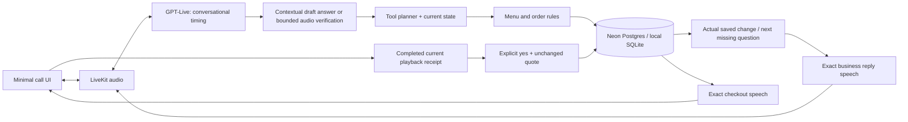

# Sawt — Saudi Arabic restaurant voice agent

> **Current source:** V3 hospitality with fixed Cedar voice, stateful ordering/support and a persistent confirmed receipt. See [current audit](CHALLENGE-AUDIT.md) before reviewing hosted behavior.

A simple call screen over a stateful ordering system. Speak naturally, give details in any order, change your mind after the total, or ask for information without placing an order. The model interprets the conversation; validated Python tools own prices, availability, saved changes and confirmation.

**Application entry points** (`app_v2.py` + `voice_worker.py`). Orders, delivery zones and staff tickets are simulated. The supplied menu is unchanged: **144 dishes, 12 categories, 4 branches, 1,728 rows**.

## Reviewer starting points

| Question | Read |
|---|---|
| How do I run it? | Setup below |
| Why this architecture? How is context managed? | [DESIGN.md](DESIGN.md) |
| Which open models would you evaluate, and why? | [EVALUATION.md](EVALUATION.md) |
| How would operations safely change behavior? | [PRODUCT.md](PRODUCT.md) |
| What should I show in the video? | [DEMO.md](DEMO.md) |
| How do I automate complete cloud calls? | [VOICE-TESTS.md](VOICE-TESTS.md) |
| Are all seven submission gates met? | [Submission checklist](SUBMISSION-READINESS.md) |
| What was tested, and what remains uncertain? | [TESTING.md](TESTING.md), [submission checks](SUBMISSION-CHECK.txt) |
| What does the assistant say? | [37 reusable phrases and request map](CALL-EXPERIENCE.txt) |

## Release audit — 2026-10-13

**Latest live retest failed; do not infer readiness from CI.** See [current results and blockers](SUBMISSION-READINESS.md#latest-retest-release-gate-failed).

Latest integration combines the Cedar voice/support fixes (`ea64d61`) with the correction, hangup and receipt regressions (`b91b0ee`). Historical [CI for f9f00ec](https://github.com/clechz/sawt_demo/actions/runs/38392581865) does not certify this integration. The current UI uses V3, model-led conversation, fixed Cedar voice. API clients that omit the experience still select V2.

**Not ready for final submission recording.** The candidate passed offline and real-provider text/state checks, but Vercel rejected production deployment with `api-deployments-free-per-day` (more than 100 deployments). The new LiveKit worker was rolled back to `TKcMfpvSprXd` to stay matched to the existing website. Latest source is on main; it is not the hosted release. Saved recording access returned HTTP 403, so the recent human call was diagnosed from persisted events/transcripts, not a fresh audio listen.

See [CHALLENGE-AUDIT.md](CHALLENGE-AUDIT.md) for evidence, coverage, limitations and exact remaining release steps. Older V2/V30/V31 results below are historical and do not certify this candidate.

## Hosted demo

The hosted demo is at **https://sawt-demo.vercel.app** and uses a separately shared
demo password. Vercel serves the UI/API, LiveKit Cloud runs the voice worker,
Neon Postgres stores transactional order state, and private Vercel Blob stores
recordings/readbacks. The hosted app does not require a local server or tunnel.
See [cloud deployment and verification](CLOUD-DEPLOYMENT.md).

The shared demo budget defaults to **120 call starts per hour and four concurrent calls**. Configure `SAWT_MAX_CALLS_PER_HOUR` and `SAWT_MAX_ACTIVE_CALLS` on the API host. A single database-backed check enforces both across processes; closed calls still count toward the hourly budget. Provider billing and provider quotas are separate.

## Run locally (V3 UI; compatible V2 API)

### Requirements

- Python **3.12**, Git; two terminals in the repository root.
- A funded OpenAI API key with access to the configured GPT-Live, transcription, planner and speech models. A ChatGPT subscription alone is not an API credential.
- A LiveKit Cloud project: its WebSocket URL, API key and API secret.
- A microphone and a browser supporting WebRTC. Use `localhost` for microphone access; another device requires trusted HTTPS.
- Node **22+** only for frontend development and the JavaScript checks. Built frontend assets are committed, so Node is not needed merely to run the app.

### Windows PowerShell

```powershell
git clone https://github.com/clechz/sawt_demo.git
cd sawt_demo
py -3.12 -m venv .venv
.\.venv\Scripts\python.exe -m pip install -r requirements-v2.txt
Copy-Item .env.example .env
notepad .env
```

Set these four values in `.env` (never commit the file):

```dotenv
OPENAI_API_KEY=your-funded-api-key
LIVEKIT_URL=wss://your-project.livekit.cloud
LIVEKIT_API_KEY=your-project-api-key
LIVEKIT_API_SECRET=your-project-api-secret
```

The V3 UI explicitly selects Cedar for GPT-Live conversation and exact validated readbacks. API clients omitting an experience retain the V2 compatibility path.

Keep the model defaults in `.env.example` unless your account requires an explicitly validated alternative. `SAWT_VOICE=marin` controls the V2 live voice, exact readback and recovery voice together. `TTS_VOICE` is the legacy V1 setting. Changing `LLM_MODEL` changes the tool planner, not the GPT-Live voice model.

Terminal 1:

```powershell
.\.venv\Scripts\python.exe -m uvicorn app_v2:app --host 127.0.0.1 --port 8766
```

Terminal 2, in the same repository:

```powershell
.\.venv\Scripts\python.exe voice_worker.py start
```

Wait for the worker's **registered worker** log, then open **http://127.0.0.1:8766**. Click the call action and allow the microphone. End the call before stopping either terminal with Ctrl+C. Restart both processes after changing server configuration or spoken templates.

### macOS / Linux

```bash
git clone https://github.com/clechz/sawt_demo.git
cd sawt_demo
python3.12 -m venv .venv
.venv/bin/python -m pip install -r requirements-v2.txt
cp .env.example .env
# Edit .env with the same four values above.
.venv/bin/python -m uvicorn app_v2:app --host 127.0.0.1 --port 8766
```

In a second terminal:

```bash
cd sawt_demo
.venv/bin/python voice_worker.py start
```

### First call

Say: **«أبي شكشوكة حجم كبير مع تميس، عدد اثنين، توصيل للرياض حي النرجس شارع التجربة مبنى ١٢.»**

Then say **«غيرها استلام من فرع النرجس»**, then **«خلها وحدة بس»**. Request the summary, let the complete readback finish, then say **«اعتمد الطلب»**. Expected totals: delivery **75 SAR**, pickup **60 SAR**, one item for pickup **30 SAR**. The receipt shows a mock order ID only after confirmation.

## How the pieces fit



The caller sees an orb, a call action and order details. Debugging information stays off the caller screen. The complexity exists at the boundaries where mistakes matter: interpreting a correction, invalidating an old total, distinguishing yes-to-an-option from yes-to-an-order, and rejecting work overtaken by new speech.

## Tests and frontend build

From an activated virtual environment (`.\.venv\Scripts\Activate.ps1` or `source .venv/bin/activate`):

```bash
python -m pytest -q
node --test tests/playback.test.mjs tests/audio-meter.test.mjs tests/call-status.test.mjs tests/call-start.test.mjs
npm ci --prefix frontend
npm run build --prefix frontend
```

If PowerShell blocks activation, use `.\.venv\Scripts\python.exe` instead of `python`; activation is optional. `npm run build` typechecks and regenerates `static/v2/ui` from the React orb source.

Paid provider checks (no Chrome automation):

```bash
python scripts/v2_interaction_eval.py
python scripts/v2_release_replay.py
# Deployed four-turn ordering acceptance (not all challenge scenarios):
python scripts/verify_challenge_voice.py
# Requires the API and voice worker running on localhost:8766:
python scripts/v2_recognition_replay.py --edges
```

Offline checks do not need funded provider credentials. Live checks do, and synthetic voice is not a substitute for a held-out Saudi-speaker evaluation. GitHub Actions runs Python/JavaScript tests and the frontend build; it does not run paid calls. Saved evidence distinguishes backend simulation, real media, and human observations.

## Troubleshooting and operating boundaries

- **Configured false:** check `/api/health` and all four credentials; health confirms configuration presence, not provider entitlement.
- **`credit_balance_exhausted` / `insufficient_quota`:** restore OpenAI API credit. Raising the app's 120/hour budget cannot fix provider billing. The cloud suite checks this before starting paid voice journeys, and billing failures close calls instead of asking the caller to repeat.
- **Call connects but no assistant:** check the worker is registered as `sawt-v2`, both processes use the same `.env`/LiveKit project, and provider credit/access is available.
- **No microphone:** check the browser permission and selected device. HTTP on a LAN IP is not a secure microphone context; use localhost or trusted HTTPS.
- **Slow or missed speech:** inspect local `/recordings` and `python scripts/v2_call_audit.py`; distinguish capture, recognition verification, planner and playback timings. A successful backend test alone does not establish good audio latency.
- **Yes did not confirm:** wait for the whole latest readback. Interruption, edits or failed playback invalidate its receipt.
- **Already confirmed:** a second yes returns the existing order, never a second order. Real amendments require a staff integration that this demo does not have.

Local state is `runtime/v2.sqlite3`; diagnostic audio is in `runtime/recordings` with bounded retention. These files and `.env` are ignored. Host-only diagnostics can contain transcripts and addresses. Use fictional details when demonstrating. The local API is not a public deployment target: `private_demo.py` provides the optional password gateway, and deployment needs an HTTPS proxy plus a continuously running host. Never expose the unprotected local diagnostics server directly.

Branch zones/fees are fixed fixture assumptions, not geocoding. No payment, inventory reservation, real courier tracking or live human transfer is implemented. The prototype is not presented as production-ready or perfect recognition. A video under ten minutes and reviewer access are submission deliverables, not generated by the app.

## Source map

- `voice_worker.py`: audio lifecycle, verification, interruptions, speech and call closure.
- `sawt/agent.py`: bounded interpretation/tool loop; no separate intent classifier.
- `sawt/domain.py`: menu validation, integer-halalas pricing, fulfillment and exact summaries.
- `sawt/transactions.py`: SQLite revisions, epochs, idempotency and playback receipts.
- `sawt/clarification.py`, `response_style.py`: contextual answers and actual-change wording.
- `data/conversation-copy.json`: reusable Arabic copy, separate from business decisions.
- `frontend/`, `static/v2/`: React orb source and caller app/assets.

The preserved V1 push-to-talk app (`app.py`, port 8765) is historical. Its older setup/design notes are in [docs/legacy-v1](docs/legacy-v1); use the V2 instructions above for this submission.
